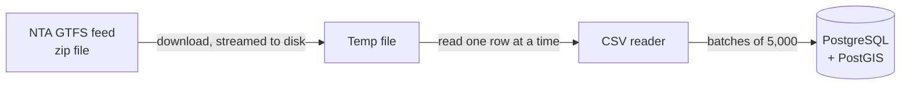
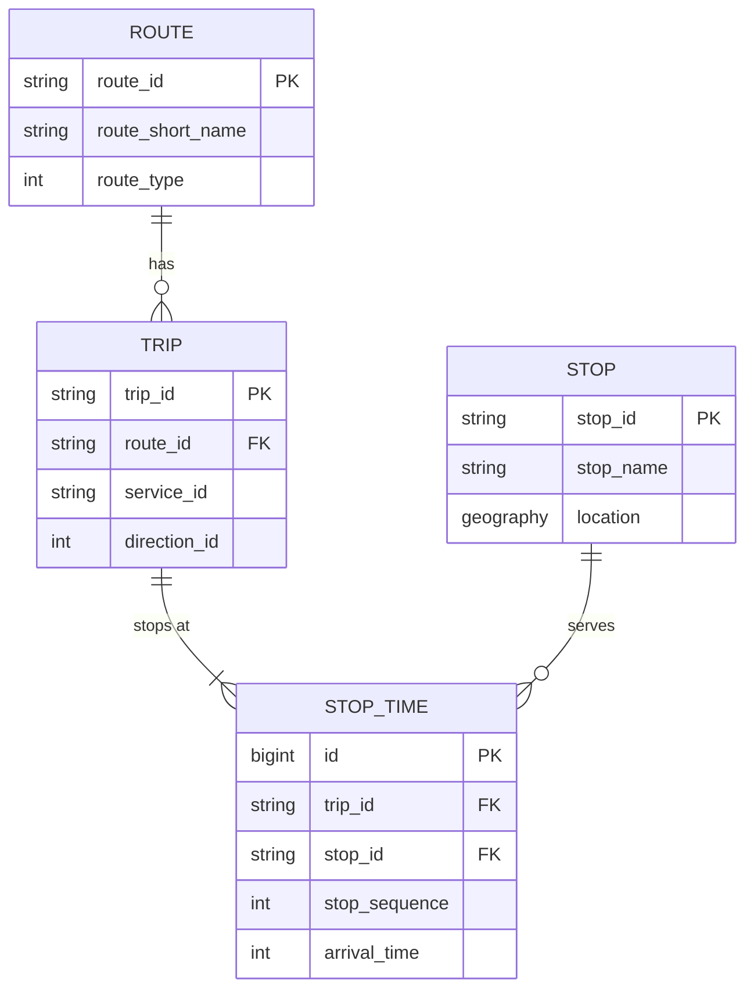

# Dublin Transit Monitor

A backend service that imports Ireland's public transport schedule (bus, rail and Luas) from the National Transport Authority's open GTFS feed and answers one question fast: **which stops are near me?**

This is the first stage of a real-time transit monitor. Later stages add live arrival predictions from the GTFS-Realtime feed, a live-updating API and an Angular map.

## Features

- **Daily schedule import:** downloads the full GTFS feed (~8 million rows) and loads it into PostgreSQL in a single transaction.
- **Nearby stop search:** finds stops within a radius of any point, ordered by distance, using PostGIS and a spatial index.
- **REST API:** validated query parameters and [RFC 9457](https://www.rfc-editor.org/rfc/rfc9457) problem responses for invalid input.
- **Tested against a real database:** integration tests run on PostGIS through Testcontainers.

## Tech stack

| Area | Technology |
|---|---|
| Language | Java 25 |
| Framework | Spring Boot 4 (Web MVC, Data JPA, Validation, Actuator) |
| Database | PostgreSQL 17 + PostGIS 3.5 |
| Migrations | Flyway |
| Bulk loading | Spring `JdbcTemplate` batch inserts |
| CSV parsing | Apache Commons CSV |
| Testing | JUnit 5, AssertJ, Mockito, Testcontainers |
| Local environment | Docker Compose |

## How it works

### Import pipeline



1. `GtfsImportJob` triggers an import every day at 04:00 Dublin time, and on startup when the database is empty.
2. `GtfsDownloader` streams the zip straight to a temporary file, so the feed never sits in memory.
3. `GtfsCsvReader` reads each file one row at a time and maps it to a typed record (`StopRow`, `TripRow`, ...).
4. `GtfsImportService` writes the rows in batches with `JdbcTemplate.batchUpdate`, inside one transaction.

### Data model



Figures from a full import of the national feed:

| File | Rows |
|---|---:|
| `routes.txt` | 402 |
| `stops.txt` | 10,276 |
| `trips.txt` | 226,848 |
| `stop_times.txt` | 8,118,623 |

| Configuration | Import time |
|---|---:|
| Batches of 5,000 | 362 s |
| Batches of 5,000 + `reWriteBatchedInserts=true` | _TODO_ |

### Spatial index

The nearby search uses a GiST index on `stops.location`. Searching 300 m around the Spire:

| | Rows checked | Execution time |
|---|---:|---:|
| Without index (`Seq Scan`) | 10,276 | _TODO_ |
| With GiST index (`Bitmap Index Scan`) | 52 | _TODO_ |

The index first finds candidates inside a bounding box around the search area, then the exact distance check filters them down to the 22 stops inside the circle.

## API

### Find nearby stops

```
GET /api/stops/nearby?lat={lat}&lon={lon}&radius={metres}&limit={n}
```

| Parameter | Required | Default | Range |
|---|---|---|---|
| `lat` | yes | | -90 to 90 |
| `lon` | yes | | -180 to 180 |
| `radius` | no | 500 | 1 to 2,000 metres |
| `limit` | no | 20 | 1 to 50 |

Example:

```bash
curl "http://localhost:8080/api/stops/nearby?lat=53.3498&lon=-6.2603&radius=300&limit=2"
```

```json
[
  {
    "id": "...",
    "code": "...",
    "name": "O'Connell St Upr",
    "lat": 53.35,
    "lon": -6.26,
    "distanceMeters": 42
  },
  {
    "id": "...",
    "code": "...",
    "name": "The Spire of Dublin",
    "lat": 53.35,
    "lon": -6.26,
    "distanceMeters": 48
  }
]
```

Invalid parameters return `400 Bad Request` with the reason for each one:

```json
{
  "type": "about:blank",
  "title": "Bad Request",
  "status": 400,
  "detail": "Invalid request parameters",
  "errors": { "lat": ["must be less than or equal to 90"] }
}
```

## Running locally

Requirements: Java 25, Maven 3.9+, Docker.

```bash
# Start PostgreSQL with PostGIS
docker compose up -d

# Run the application (Flyway creates the schema on startup)
mvn spring-boot:run
```

On the first run the database is empty, so the application downloads and imports the full feed before it is ready. This takes a few minutes. Later starts skip the import.

```bash
# Check that it is running
curl http://localhost:8080/actuator/health
```

### Configuration

| Property | Default | Description |
|---|---|---|
| `gtfs.static-url` | NTA `GTFS_Realtime.zip` | Feed to import |
| `gtfs.import-cron` | `0 0 4 * * *` | Daily import schedule (Dublin time) |
| `gtfs.import-on-startup` | `true` | Import on startup when the database is empty |

## Tests

```bash
mvn test     # unit tests, no Docker needed
mvn verify   # unit and integration tests (Docker must be running)
```

Integration tests (`*IT`) start a throwaway PostGIS container with Testcontainers and import a small hand-made GTFS feed, so they run without network access.

## Project structure

```
src/main/java/com/mtspadda/transit/
├── gtfs/      # Feed download, CSV parsing, import and scheduling
│   └── row/   # Records that mirror each GTFS file
├── stop/      # Stop entity, nearby search and REST API
├── route/     # Route entity
├── trip/      # Trip and StopTime entities
└── common/    # Shared error handling
```

## Roadmap

- [x] **Stage 1:** GTFS schedule import and nearby stop search
- [ ] **Stage 2:** Real-time arrival predictions from GTFS-Realtime (Protocol Buffers)
- [ ] **Stage 3:** Redis cache and live updates over WebSocket / Server-Sent Events
- [ ] **Stage 4:** Angular frontend with a Leaflet map
- [ ] **Stage 5:** Delay statistics, alerts and deployment to AWS

## Data source

Transport data is provided by the [National Transport Authority](https://www.nationaltransport.ie/) through [Transport for Ireland](https://www.transportforireland.ie/) open data.